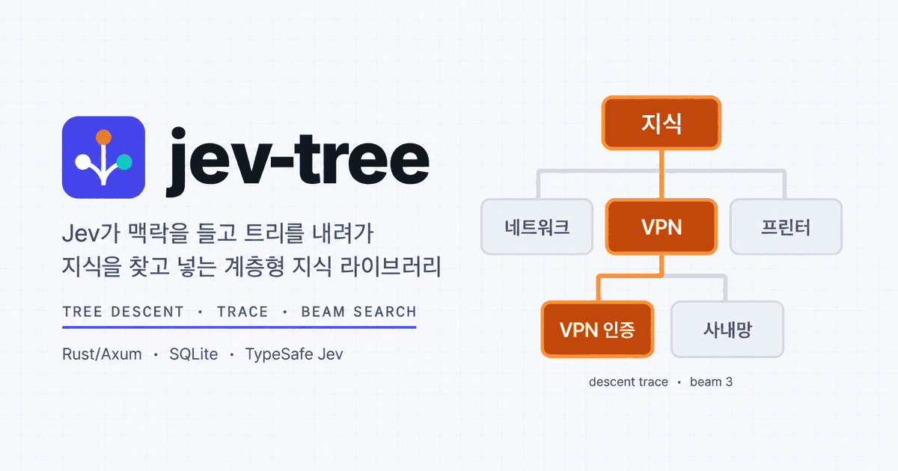
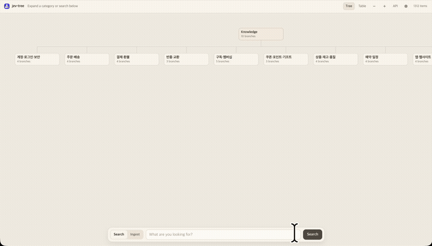

# jev-tree

<p align="center">
  
</p>

<p align="center">
  <a href="static/demo.mp4">
    
  </a>
</p>

<p align="center"><sub>▶ <a href="static/demo.mp4">Full demo video</a></sub></p>

People do not pick folders. A model carries the context down a tree and finds or files knowledge.

One Rust process (Axum + SQLite/WAL) that stores Q&A in a taxonomy and reaches it by
model-driven tree descent. **Search and ingest are the same descent.**

## Run

```bash
cargo run --release      # from the repo root
# UI    http://127.0.0.1:8768            (forest)
#        http://127.0.0.1:8768/products  (that child as the page root)
# Docs  http://127.0.0.1:8768/docs      (spec: /api/openapi.json)
```

Default paths are relative (`data/db.sqlite3`, `data/seed.json`, `static/`), so the repo root
must be the working directory. The bundled seed is fictional: 604 categories, 1,312 items,
max depth 10.

A Jev API key is required. The LLM is optional.

| Missing | Effect |
|---|---|
| Jev API key | Search and ingest return 400. `GET /api/health` → `evaluator` is `unconfigured` |
| LLM base, token, or model | Jev's pick always stands. A failed or slow LLM call does the same |
| Login password | Open mode: every endpoint is reachable without a token |

## How it works

1. Knowledge lives in a taxonomy tree. `/` is the forest; `/products` (then
   `/products/products_stock`, …) makes that child the page root. Search and ingest
   stay inside it. Settings and keys do not.
2. Routing is **one Jev choice over the walk's menu** — no level-by-level guessing, so no
   choice is made blind to the rest of the tree and one wrong level cannot lose the leaf.
   The menu is every node in scope while one choice can name them (Jev takes 255 options,
   so up to 254 nodes and 80 KB of menu text). A bigger tree gets a **coarse map** first —
   one Jev choice over the deepest level that still fits, whose best branches are opened
   whole — plus **BM25** matches over every node's text and the questions filed under it.
   A pick whose branch did not fit is walked into. `__none__` abstains (a `root` scope
   abstains for "outside this root"); a `start_node` walk stays in that subtree and cannot.
3. **The LLM fills Jev's gaps instead of replacing it.** When an LLM base URL, token, and
   model are all set, it reviews only the picks Jev is unsure of (chosen probability below
   0.8), reading the same menu Jev chose from. Confident picks never wait for it.
4. `search` ranks **every active item** under the selected node with Jev (Noul and Score),
   in batches of up to 32 items and 24 KB, then keeps `limit`. When the route was unsure
   (below 0.9) the two next-best nodes' items are ranked too, and they answer only at 0.75
   or more. `ingest` routes a new Q&A through the same descent and stores it as `qa`.
5. A `trace` lists the steps: the coarse map (big trees), the choice with its candidates
   and probabilities (`trace.score` is the chosen probability), and an `llm review` or a
   `scope check` when the pick was unsure. An LLM-reviewed route leaves `trace.score` null;
   it does not write `1.0`.

Read a search result by role, never by `items[0]`:

| field | meaning |
|---|---|
| `items[].role` | `recommended` ≥ 0.65 · `alternative` ≥ 0.40 · else `reference` |
| `abstained: true` | the best item is weak (score < 0.45, or < 0.30 with directness < 1.0) — say "I don't know" |
| `leaf_id: null` | outside the tree; `items` is empty |

## API in 30 seconds

```bash
curl -s localhost:8768/api/run -H 'content-type: application/json' \
  -d '{"mode":"search","query":"my parcel is stuck at customs"}'

# same search, but only under the products subtree
curl -s localhost:8768/api/run -H 'content-type: application/json' \
  -d '{"mode":"search","query":"out of stock","root":"products"}'

# ingest files a draft and returns its item_id; publishing is a second, explicit call
curl -s localhost:8768/api/run -H 'content-type: application/json' \
  -d '{"mode":"ingest","question":"...","answer":"..."}'
```

`mode` is `search` or `ingest` only. A draft is stored with `status=draft` and stays out of
search until you re-send it with `auto_publish: true`, or drop it with
`DELETE /api/items/{id}`. Full contract: [`docs/api.md`](docs/api.md) or `/api/openapi.json`.

## Configuration

Environment variables carry deployment paths only. Runtime settings (keys, branding)
live in SQLite and are changed through `PATCH /api/settings`.

| Variable | Default | Purpose |
|---|---|---|
| `PORT` | `8768` | Listen port |
| `JEV_TREE_BIND` | `127.0.0.1` | Any non-loopback value requires a login password (see below) |
| `JEV_TREE_ALLOW_OPEN` | — | `1` allows a public bind without a login password. Understand the risk first |
| `JEV_TREE_DB` | `data/db.sqlite3` | SQLite file |
| `JEV_TREE_SEED` | `data/seed.json` | Seed used on first boot and by `POST /api/seed` |
| `JEV_TREE_STATIC_DIR` | `static` | UI + `openapi.json` |
| `JEV_TREE_SECRET_KEY_FILE` / `JEV_TREE_SECRET_KEY` | — | Material for encrypting stored secrets; otherwise a `0600` sibling `.jev-tree.key` is created |
| `JEV_TREE_RUN_TIMEOUT_SECS` | `120` | Deadline for one search or ingest |
| `JEV_TREE_INIT_*` | — | One-way boot seed for `API_KEY`, `BASE_URL`, `TOKEN`, `MODEL`, `SERVER_KEY`. Fills **empty** DB slots only |

## Deploying

Binding anything other than loopback without a login password is refused at startup, because
open mode lets any caller claim the password and reset the database:

```bash
JEV_TREE_BIND=0.0.0.0 JEV_TREE_INIT_SERVER_KEY=<6+ chars> cargo run --release
```

`POST /api/seed` deletes every category and item. Never point it at a live database.
The bundled `Dockerfile` follows the same rules: non-root user, `ca-certificates` installed
so outbound TLS verifies against the system trust store, and `SIGTERM` (`docker stop`) drains
in-flight runs the same way Ctrl-C does. More in [`AGENTS.md`](AGENTS.md#deployment-safety).

## Status

`cargo fmt --check`, `cargo test --locked`, and
`cargo clippy --all-targets --locked -- -D warnings` run in CI. They cover the HTTP
contract, scripted-evaluator descent, taxonomy validation, secret handling, and the
startup guards.

The UI and `/docs` make no external requests: no CDN, no web fonts, no analytics.
CI does not call Jev. Scripted tests cover routing, descent, the full-subtree ranking pool,
the missing-key error, and an LLM failure falling back to Jev routing.

Known gaps are tracked in [`AGENTS.md`](AGENTS.md#known-gaps). Read them before trusting a result.

## Evaluation

Two Korean datasets, one runner. It runs in-process through `engine::execute` — no server
started, nothing written to the working tree's database.

| dataset | tree | items | cases |
|---|---|---:|---:|
| [`eval/`](eval/README.md) golden set, hand-labelled | 8 domains, 219 nodes (fits one Jev choice) | 669 | 525 |
| [`eval/large`](eval/large/README.md) synthetic, judge-checked | 33 domains, 1,902 nodes | 14,870 | 3,860 |

```bash
cargo run --release --example eval -- validate --strict        # dataset check, no key needed
cargo run --release --example eval -- run --router both --variant all
cargo run --release --example eval -- run --eval-dir eval/large --variant full \
    --router both --sample 1500 --seed final
```

Large benchmark, 1,500 paired cases (`jev-latest`; LLM `muse-spark`):

| routing | E2E | route | Hit@1 | latency p50 | billed tokens / search |
|---|---:|---:|---:|---:|---:|
| 0.9.0 — Jev, lexical recall menu | 68.4% | 48.5% | 67.8% | 0.7s | 45.4K |
| 0.9.0 — LLM routes every request (600 of the cases) | 73.7% | 64.2% | 72.4% | 12.1s | 12.4K + 6.2K LLM |
| 0.10.0 — Jev, coarse map + BM25, rescue | 82.0% | 68.7% | 82.6% | 0.9s | 38.7K |
| 0.10.0 — + LLM reviews unsure picks | **83.8%** | **75.5%** | **84.5%** | 1.8s | 36.4K + 3.3K LLM |

Golden set, `standard` tree:

| routing | E2E | Hit@1 | ingest | latency p50 |
|---|---:|---:|---:|---:|
| 0.9.0 — Jev | 97.3% | 97.3% | 92.6% | 0.5s |
| 0.9.0 — LLM routes every request | 97.7% | 97.6% | 100% | 3.8s |
| 0.10.0 — Jev | 98.0% | 98.1% | 94.1% | 0.4s |
| 0.10.0 — Jev + LLM reviews unsure picks (13%) | **98.4%** | **98.4%** | **100%** | **0.4s** |

Things worth knowing before trusting a result:

- **The golden set could not see the problem.** Its tree fits one Jev choice, so every
  request saw every node. At 1,902 nodes the old menu (nodes sharing the most characters
  with the request) held the right node 69% of the time; the coarse map plus BM25 holds it
  98% of the time with a menu a third the size.
- **Most misses on a big tree are sideways**, between nodes whose scopes overlap. Ranking
  the runners-up of an unsure route recovers them (+9.7pp E2E on its own), and a higher bar for
  their items (0.75) keeps false answers where they were.
- **The LLM is worth most where Jev is unsure, and only there.** Reviewing 13% of golden
  requests matches routing all of them, at a tenth of the median latency and a seventh of
  the LLM tokens. It must see the whole menu: given only Jev's favourites it repeats Jev's
  mistakes.
- **Read relative numbers on `eval/large`.** Its domains overlap by design and its labels are
  strict, so absolute accuracy is understated; the paired comparisons are what to trust.

Method, metrics, and the history of each change: [`eval/README.md`](eval/README.md),
[`eval/results/README.md`](eval/results/README.md).


## Documents

| File | Contents |
|---|---|
| [`AGENTS.md`](AGENTS.md) | Operating manual for agents and contributors — start here |
| [`docs/api.md`](docs/api.md) | HTTP contract |
| [`static/openapi.json`](static/openapi.json) | Machine-readable contract (hand-maintained) |
| [`eval/README.md`](eval/README.md) | Golden-set evaluation: dataset, runner, measured results |
| [`.agents/skills/bootstrap/SKILL.md`](.agents/skills/bootstrap/SKILL.md) | Building a taxonomy from raw data |

## Security

Report key or auth bugs privately — see [`SECURITY.md`](SECURITY.md).

## License

MIT — [`LICENSE`](LICENSE). Copyright (c) 2026 lee-lou2 &lt;lee@lou2.kr&gt;.
