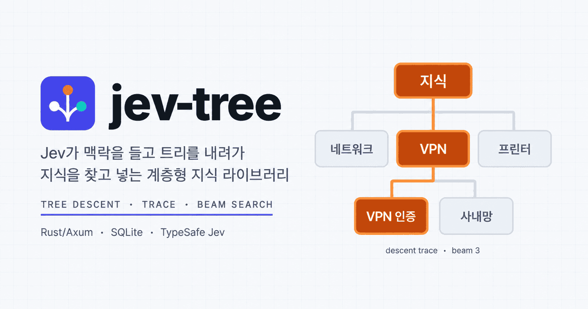
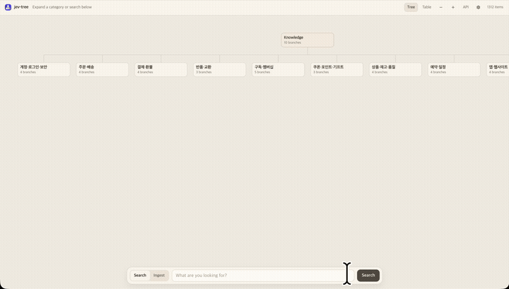

# jev-tree

<p align="center">
  
</p>

<p align="center">
  <a href="static/demo.mp4">
    
  </a>
</p>

<p align="center"><sub>▶ <a href="static/demo.mp4">Full demo video</a></sub></p>

People do not pick folders. A model carries the context down a tree and finds or files knowledge.

One Rust process (Axum + SQLite/WAL) that stores Q&A in a taxonomy and reaches it by
model-driven tree descent. **Search and ingest are the same descent.**

## Run

```bash
cargo run --release      # from the repo root
# UI    http://127.0.0.1:8768            (forest)
#        http://127.0.0.1:8768/products  (that child as the page root)
# Docs  http://127.0.0.1:8768/docs      (spec: /api/openapi.json)
```

Default paths are relative (`data/db.sqlite3`, `data/seed.json`, `static/`), so the repo root
must be the working directory. The bundled seed is fictional: 604 categories, 1,312 items,
max depth 10.

A Jev API key is required. The LLM is optional.

| Missing | Effect |
|---|---|
| Jev API key | Search and ingest return 400. `GET /api/health` → `evaluator` is `unconfigured` |
| LLM base, token, or model | Jev's pick always stands. A failed or slow LLM call does the same |
| Login password | Open mode: every endpoint is reachable without a token |

## How it works

1. Knowledge lives in a taxonomy tree. `/` is the forest; `/products` (then
   `/products/products_stock`, …) makes that child the page root. Search and ingest
   stay inside it. Settings and keys do not.
2. Routing is **one Jev choice over the walk's menu** — no level-by-level guessing, so no
   choice is made blind to the rest of the tree and one wrong level cannot lose the leaf.
   The menu is every node in scope while one choice can name them (Jev takes 255 options,
   so up to 254 nodes and 74 KB of menu text), in tree order. A bigger tree gets a
   **coarse map** first — one Jev choice over the deepest level that still fits, whose best
   branches are opened whole — plus **BM25** matches over every node's text and the
   questions filed under it. A pick whose branch did not fit is walked into. `__none__`
   abstains when it is more likely than not (a `root` scope abstains for "outside this
   root"); a `start_node` walk stays in that subtree and cannot.
3. **A node shows what is filed under it.** On a search, each node in the menu ends with
   the questions already filed there that share the request's words. A description says
   what a node is meant to hold; the questions show what it does hold. That one line of
   evidence moved the right-node rate on a 1,902-node tree from 70% to 85%.
4. **The LLM fills Jev's gaps instead of replacing it.** When an LLM base URL, token, and
   model are all set, it reviews only the picks Jev is unsure of (chosen probability below
   0.8), reading the same menu Jev chose from. Confident picks never wait for it.
5. `search` ranks **a pool, not just a subtree**, with Jev (Noul and Score), in batches of
   up to 32 items and 24 KB, then keeps `limit`. The pool is every active item under the
   selected node, the two next-best nodes' items when the route was unsure (below 0.9),
   and the 20 items in scope that share the most words with the request, wherever they
   are filed. An answer one branch over from where the route landed is still found.
   `ingest` routes a new Q&A through the same descent and stores it as `qa`.
6. A `trace` lists the steps: the coarse map (big trees), the choice with its candidates
   and probabilities (`trace.score` is the chosen probability), and an `llm review` when
   the pick was unsure. An LLM-reviewed route leaves `trace.score` null; it does not
   write `1.0`.

Read a search result by role, never by `items[0]`:

| field | meaning |
|---|---|
| `items[].role` | `recommended` ≥ 0.65 · `alternative` ≥ 0.40 · else `reference` |
| `abstained: true` | the best item scores below 0.55 — say "I don't know"; every item is a `reference` |
| `leaf_id: null` | outside the tree: the route refused and no item answers (`abstained` is true) |

## API in 30 seconds

```bash
curl -s localhost:8768/api/run -H 'content-type: application/json' \
  -d '{"mode":"search","query":"my parcel is stuck at customs"}'

# same search, but only under the products subtree
curl -s localhost:8768/api/run -H 'content-type: application/json' \
  -d '{"mode":"search","query":"out of stock","root":"products"}'

# ingest files a draft and returns its item_id; publishing is a second, explicit call
curl -s localhost:8768/api/run -H 'content-type: application/json' \
  -d '{"mode":"ingest","question":"...","answer":"..."}'
```

`mode` is `search` or `ingest` only. A draft is stored with `status=draft` and stays out of
search until you re-send it with `auto_publish: true`, or drop it with
`DELETE /api/items/{id}`. Full contract: [`docs/api.md`](docs/api.md) or `/api/openapi.json`.

## Configuration

Environment variables carry deployment paths only. Runtime settings (keys, branding)
live in SQLite and are changed through `PATCH /api/settings`.

| Variable | Default | Purpose |
|---|---|---|
| `PORT` | `8768` | Listen port |
| `JEV_TREE_BIND` | `127.0.0.1` | Any non-loopback value requires a login password (see below) |
| `JEV_TREE_ALLOW_OPEN` | — | `1` allows a public bind without a login password. Understand the risk first |
| `JEV_TREE_DB` | `data/db.sqlite3` | SQLite file |
| `JEV_TREE_SEED` | `data/seed.json` | Seed used on first boot and by `POST /api/seed` |
| `JEV_TREE_STATIC_DIR` | `static` | UI + `openapi.json` |
| `JEV_TREE_SECRET_KEY_FILE` / `JEV_TREE_SECRET_KEY` | — | Material for encrypting stored secrets; otherwise a `0600` sibling `.jev-tree.key` is created |
| `JEV_TREE_RUN_TIMEOUT_SECS` | `120` | Deadline for one search or ingest |
| `JEV_TREE_LOG_QUERIES` | on | `0` leaves the request text out of the per-run log line (see [`SECURITY.md`](SECURITY.md)) |
| `JEV_TREE_INIT_*` | — | One-way boot seed for `API_KEY`, `BASE_URL`, `TOKEN`, `MODEL`, `SERVER_KEY`. Fills **empty** DB slots only |

## Deploying

Binding anything other than loopback without a login password is refused at startup, because
open mode lets any caller claim the password and reset the database:

```bash
JEV_TREE_BIND=0.0.0.0 JEV_TREE_INIT_SERVER_KEY=<6+ chars> cargo run --release
```

`POST /api/seed` deletes every category and item. Never point it at a live database.
The bundled `Dockerfile` follows the same rules: non-root user, `ca-certificates` installed
so outbound TLS verifies against the system trust store, and `SIGTERM` (`docker stop`) drains
in-flight runs the same way Ctrl-C does. More in [`AGENTS.md`](AGENTS.md#deployment-safety).

## Status

`cargo fmt --check`, `cargo test --locked`, and
`cargo clippy --all-targets --locked -- -D warnings` run in CI. They cover the HTTP
contract, scripted-evaluator descent, taxonomy validation, secret handling, and the
startup guards.

The UI and `/docs` make no external requests: no CDN, no web fonts, no analytics.
CI does not call Jev. Scripted tests cover routing, descent, the option order sent to the
evaluator, the ranking pool (subtree, runners-up, word matches), a refusal the items
contradict, the missing-key error, and an LLM failure falling back to Jev routing.

Known gaps are tracked in [`AGENTS.md`](AGENTS.md#known-gaps). Read them before trusting a result.

## Evaluation

Two Korean datasets, one runner. It runs in-process through `engine::execute` — no server
started, nothing written to the working tree's database.

| dataset | tree | items | cases |
|---|---|---:|---:|
| [`eval/`](eval/README.md) golden set, hand-labelled | 8 domains, 219 nodes (fits one Jev choice) | 669 | 525 |
| [`eval/large`](eval/large/README.md) synthetic, judge-checked | 33 domains, 1,902 nodes | 14,870 | 3,860 |

```bash
cargo run --release --example eval -- validate --strict        # dataset check, no key needed
cargo run --release --example eval -- run --router both --variant all
cargo run --release --example eval -- run --eval-dir eval/large --variant full \
    --router both --sample 1500 --seed final
```

Large benchmark, 1,500 paired cases (0.9–0.10 under `jev-1.13.0` with LLM `muse-spark`;
0.11 under `jev-1.14.0` with LLM `muse-ember-1.0` at `low`):

| routing | E2E | route | Hit@1 | latency p50 | billed tokens / search |
|---|---:|---:|---:|---:|---:|
| 0.9.0 — Jev, lexical recall menu | 68.4% | 48.5% | 67.8% | 0.7s | 45.4K |
| 0.9.0 — LLM routes every request (600 of the cases) | 73.7% | 64.2% | 72.4% | 12.1s | 12.4K + 6.2K LLM |
| 0.10.0 — Jev, coarse map + BM25, rescue | 82.0% | 68.7% | 82.6% | 0.9s | 38.7K |
| 0.10.0 — + LLM reviews unsure picks (50%) | 83.8% | 75.5% | 84.5% | 1.8s | 36.4K + 3.3K LLM |
| 0.11.0 — Jev, filed questions in the menu, word matches in the pool | 86.8% | 82.6% | 88.1% | 0.8s | 40.2K |
| 0.11.0 — + LLM reviews unsure picks (29%) | **87.5%** | **85.9%** | **89.1%** | 0.8s | 39.4K + 2.4K LLM |

Golden set, `standard` tree:

| routing | E2E | route | Hit@1 | ingest | latency p50 |
|---|---:|---:|---:|---:|---:|
| 0.9.0 — Jev | 97.3% | 93.7% | 97.3% | 92.6% | 0.5s |
| 0.9.0 — LLM routes every request | 97.7% | 96.6% | 97.6% | 100% | 3.8s |
| 0.10.0 — Jev | 98.0% | 93.7% | 98.1% | 94.1% | 0.4s |
| 0.10.0 — Jev + LLM reviews unsure picks (13%) | 98.4% | 96.9% | 98.4% | 100% | 0.4s |
| 0.11.0 — Jev | 98.2% | **97.3%** | **98.7%** | 95.6% | 0.5s |
| 0.11.0 — Jev + LLM reviews unsure picks (9%) | 97.7% | 96.8% | **98.7%** | **100%** | 0.5s |

A live customer-support tree (246 nodes, 2,534 items; 489 real requests; not in the repo):

| | top item answers | answer among results | refused, no result |
|---|---:|---:|---:|
| 0.10.1 — Jev | 70.9% | 81.8% | 21 |
| 0.11.0 — Jev | 80.2% | 95.3% | 1 |
| 0.11.0 — Jev + LLM reviews unsure picks (45%) | **82.1%** | **96.6%** | 1 |

Things worth knowing before trusting a result:

- **A tidy benchmark hides what a maintained tree does.** The golden set said 98% while the
  live tree said 61% end to end. In a tree people maintain, a node's description does not
  name everything filed under it, so the answer often sits one node over from where the
  route lands, and a request several nodes could hold looks like it belongs to none.
  Measure on your own tree ([`eval/README.md`](eval/README.md)).
- **Evidence beats a better guess.** Showing each node's filed questions moved the right-node
  rate at 1,902 nodes from 70% to 85% with no extra model call; an LLM reviewing half the
  requests had reached 78%. And the answer is in the results 95% of the time once the
  items that share the request's words are ranked too.
- **The golden set's end-to-end number is at its ceiling** and did not move outside its noise
  (two runs of one build differ by up to 0.7 points). What it does show is the route:
  right node +1.3 to +3.7 points on every tree shape.
- **The LLM is worth most where a filing is at stake.** On a search it now changes little,
  because the pool already reaches the answer when the route is one node off. On an ingest
  the node is the result: Q&As filed in the right node went from 122 to 134 of 160 on the
  benchmark with the review. It must see the whole menu: given only Jev's favourites it
  repeats Jev's mistakes.
- **Compare runs of the same day.** `jev-latest` moved to `jev-1.14.0` in October and scores
  moved with it; the older rows above are as recorded.
- **Read relative numbers on `eval/large`.** Its domains overlap by design and its labels are
  strict, so absolute accuracy is understated; the paired comparisons are what to trust.

Method, metrics, and the history of each change: [`eval/README.md`](eval/README.md),
[`eval/results/README.md`](eval/results/README.md).


## Documents

| File | Contents |
|---|---|
| [`AGENTS.md`](AGENTS.md) | Operating manual for agents and contributors — start here |
| [`docs/api.md`](docs/api.md) | HTTP contract |
| [`static/openapi.json`](static/openapi.json) | Machine-readable contract (hand-maintained) |
| [`eval/README.md`](eval/README.md) | Golden-set evaluation: dataset, runner, measured results |
| [`.agents/skills/bootstrap/SKILL.md`](.agents/skills/bootstrap/SKILL.md) | Building a taxonomy from raw data |

## Security

Report key or auth bugs privately — see [`SECURITY.md`](SECURITY.md).

## License

MIT — [`LICENSE`](LICENSE). Copyright (c) 2026 lee-lou2 &lt;lee@lou2.kr&gt;.
